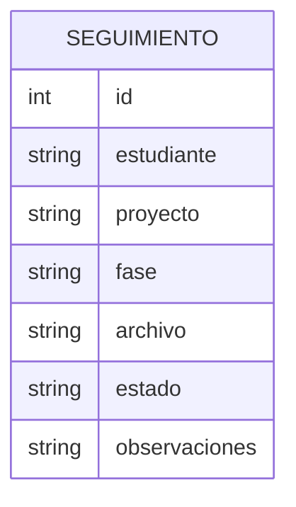
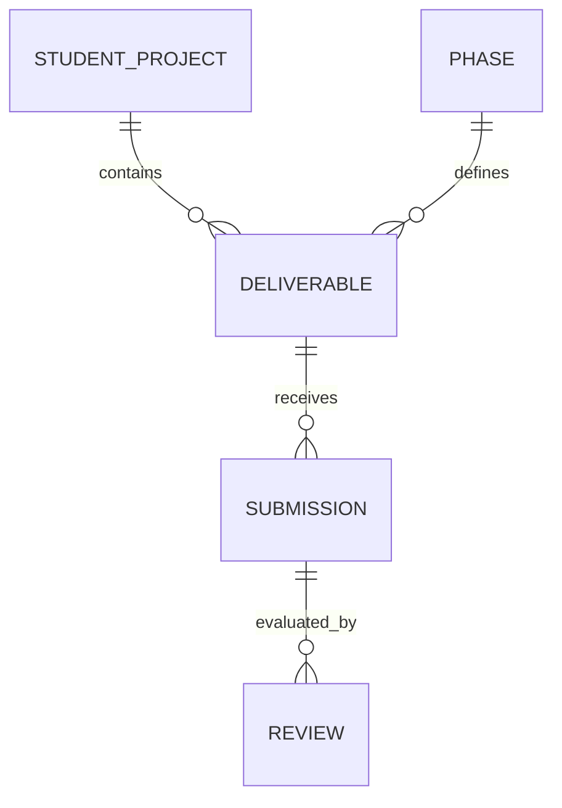

# Plan de arquitectura del módulo de seguimiento de entregas

## 1. Situación actual

El prototipo guarda estudiantes, proyectos, hitos y documentos en una única tabla `seguimiento`. Cada fila mezcla datos identificativos, fechas, rutas de archivos y observaciones del tutor. La interfaz consulta directamente esta tabla para construir el panel de seguimiento.

## 2. Limitaciones identificadas

- La información del estudiante se repite en cada fase.
- Un campo de texto representa simultáneamente fase, entrega y estado.
- No existe historial de versiones ni trazabilidad de las revisiones.
- Las rutas de archivos no están vinculadas a una entrega concreta.
- El panel depende de valores escritos manualmente y resulta difícil validarlos.

## 3. Arquitectura propuesta

Se propone separar el dominio en cinco entidades:

- `StudentProject`: identifica el TFG y su estudiante.
- `Phase`: define una fase reutilizable y su orden.
- `Deliverable`: representa una entrega solicitada para una fase.
- `Submission`: registra cada versión entregada y su referencia en GitHub.
- `Review`: conserva el resultado, las evidencias y la fecha de cada revisión.

La interfaz consultará una vista de seguimiento construida a partir de estas entidades. El estado visible se calculará con la última entrega y la última revisión, evitando duplicar datos.

## 4. Estrategia de migración

1. Crear las nuevas tablas sin retirar la estructura anterior.
2. Normalizar los nombres de fase y generar un catálogo de fases.
3. Crear un `StudentProject` por combinación única de estudiante y proyecto.
4. Convertir cada registro existente en `Deliverable`, `Submission` y, cuando proceda, `Review`.
5. Ejecutar comprobaciones de recuento, claves huérfanas y estados desconocidos.
6. Mantener temporalmente una vista compatible con el panel actual.
7. Cambiar las lecturas al nuevo modelo y retirar la tabla anterior después de validar dos ciclos completos.

La migración se ejecutará primero sobre una copia anonimizada. Cada paso será idempotente y registrará los identificadores de origen y destino.

## 5. Riesgos y mitigaciones

| Riesgo | Impacto | Mitigación |
| --- | --- | --- |
| Fases escritas con nombres diferentes | Entregas asociadas a una fase incorrecta | Tabla previa de equivalencias y listado de valores no reconocidos |
| Registros sin archivo | Entregas incompletas | Conservar el registro y marcar `missing_evidence` |
| Duplicados históricos | Recuento incorrecto | Clave de migración basada en origen y fecha |
| Ruptura del panel existente | Pérdida temporal de seguimiento | Vista de compatibilidad y despliegue gradual |
| Interpretación errónea del último estado | Información inconsistente | Regla determinista por fecha y pruebas con casos límite |

## 6. Validación

Se compararán antes y después de la migración: número de proyectos, entregables por fase, archivos referenciados y último estado visible. Las discrepancias se exportarán para su revisión. Este documento define el plan; no se realizan modificaciones en los modelos de producción.

